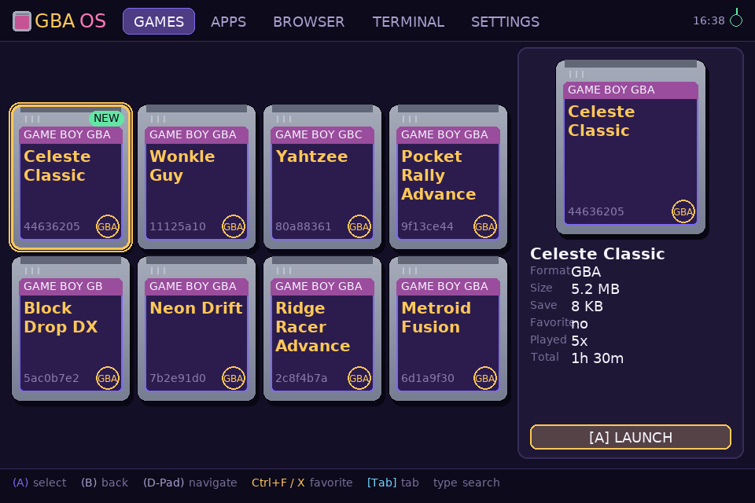
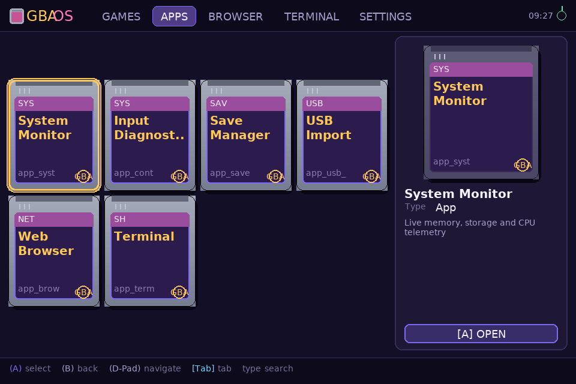
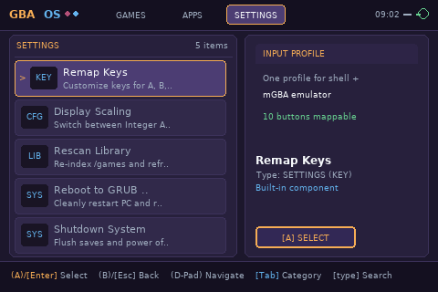

# GBA OS — A Game Boy Advance Inspired Distro (V1)

[](LICENSE)
[-purple.svg)](docs/CONTRACT.md)
[](tests)

**GBA OS** is an appliance-style Linux operating system experience designed to turn any PC or laptop into a dedicated Game Boy Advance console.

It completely dispenses with conventional desktop environments (GNOME, KDE, XFCE). When the machine powers on, it boots straight into an authentic retro console game library.



---

## 🎮 Vision & Experience

```text
Power On -> GRUB Menu -> GBA OS -> Game Library -> Play Game -> Return to Library
```

- **Zero Desktop Bloat:** Direct KMS/DRM display output. No window manager, panels, or login screens.
- **Controller-First:** Full gamepad support (including hot-plug) with a keyboard fallback.
- **Managed Saves:** Saves and states are stored per game under `/data/saves/<entry-id>/`, with a
  last-known-good backup that survives a hard power cut.
- **Persistent GRUB Safety:** Rebooting always returns to the GRUB menu so you can easily switch back to your primary desktop OS.
- **Ultra-Lightweight:** Runs well under 500 MB RAM idle, and under 1 GB RAM during emulation.
- **Recoverable:** A text-only recovery console is always reachable when the graphics stack is broken.

---

## 📸 Screenshots

| Games Library | Resource Telemetry (Apps) | System Actions (Settings) |
| :---: | :---: | :---: |
|  |  |  |

---

## ⚙️ Architecture

Built strictly against the specifications in [`docs/CONTRACT.md`](docs/CONTRACT.md) and [`docs/DECISIONS.md`](docs/DECISIONS.md):

```text
PID 1 (init / gba-init)
  └── gba-supervisor      (Headless session manager, outcome classifier, crash-loop guard)
        ├── gba-launcher  (Pixel-art retro shell; exits on selection to release display)
        └── mgba-adapter  (Isolated handler running mGBA with dedicated save routing)
```

### Process Lifecycle
1. **Supervisor** starts and executes `gba-launcher`.
2. When the user confirms a game, `gba-launcher` atomically writes a launch request to
   `/run/gba/launch_request.json` and exits cleanly (exit code `10`).
3. **Supervisor** invokes `mgba-adapter` with an isolated environment:
   - `SYS_CONTRACT=1`
   - `SYS_ENTRY_ID=<hash>`
   - `SYS_CONTENT_PATH=/games/<rom>`
   - `SYS_SAVE_DIR=/data/saves/<hash>/`
   - `SYS_DISPLAY_SCALING=integer|stretch`
4. **mgba-adapter** backs up the existing save, runs mGBA with save routing, then fsyncs the save
   files and their directory before exiting.
5. **Supervisor** requests a filesystem `sync`, records the outcome (`clean`, `crash`, `launch-failure`, …),
   and restarts `gba-launcher` focused on the previous game with the outcome banner shown.

A launcher that crashes repeatedly (3 times in 30 s) is not respawned; the supervisor drops into the
recovery console instead (contract rule S7).

---

## 🚀 Usage & Booting

### 1. Booting via GRUB (Bare-Metal Console Appliance)
During system boot, select:
```text
GBA OS (V1 Appliance Mode)
```
The machine boots directly into the fullscreen retro GBA console shell.

To return to your normal OS: navigate to **SETTINGS → Reboot to GRUB Menu**. The GRUB menu
appears with your primary operating system still selected as the default.

### 2. Testing in Windowed Mode (Inside an Existing Desktop)
```bash
make deps            # one-off: installs pygame
make run-window      # or ./scripts/launch_desktop.sh
```
The windowed session runs the real supervisor → launcher → emulator chain, so what you test is what
ships. Reboot/poweroff are simulated in this mode so your desktop is never touched.

### 3. Installing on a Machine

```bash
sudo ./scripts/install.sh          # idempotent; safe to re-run after updates
sudo ./scripts/install.sh --uninstall
```

The installer:

- copies the runtime into `/opt/gba-distro` and prepares `/data` + `/games`;
- writes the shared keyboard profile to `/data/config/keybindings.json` and `~/.config/mgba`;
- determines the root filesystem UUID and the newest installed kernel instead of hard-coding them;
- hooks tty1 (SysVinit / runit) and registers a top-level `GBA OS (V1 Appliance Mode)` GRUB entry;
- reports missing runtime packages (`python3`, `python3-pygame`, `mgba-sdl`) instead of failing at boot.

---

## 🕹️ Controls

| Action | Controller | Keyboard |
| :--- | :--- | :--- |
| **Navigate** | D-Pad / Analog Stick | `Up` / `Down` (and `PgUp` / `PgDn`) |
| **Switch Category** | D-Pad Left/Right, START | `Tab`, `Left`, `Right` |
| **Launch / Select (A)** | `A` Button (Button 0) | `Enter` / `Z` / `Space` |
| **Back / Cancel (B)** | `B` Button (Button 1) | `Esc` / `X` / `Backspace` |
| **Search library** | — | just start typing (`Backspace` edits, `Esc` clears) |
| **Emergency Recovery** | — | boot failure, or `SETTINGS → Reboot` after a crash |

All ten GBA buttons are remappable under **SETTINGS → Remap Keys**; the same profile drives both the
shell and mGBA, so a gamepad behaves identically in the two. Reserved shell keys (Esc, Tab, arrows,
Ctrl/Alt) and duplicate assignments are rejected with an inline explanation.

---

## 📂 Managing ROMs, Saves & Settings

- **Games Directory:** `/games/` (sub-folders are allowed)
  Place any `.gba`, `.gbc` or `.gb` file here. Titles are read from the cartridge header, falling
  back to a cleaned-up filename (`Pokemon Emerald (USA).gba` → `Pokemon Emerald`).
  The library rescans automatically; use **SETTINGS → Rescan Library** after copying files over.
- **Saves Directory:** `/data/saves/<entry-id>/`
  Save batteries (`.sav`) and savestates live here, keyed by content hash, so renaming a ROM never
  orphans its save. **Apps → Save Manager** shows sizes and can delete a save after confirmation.
- **Settings:** `DATA/config/` holds `keybindings.json`, `display.json` and `history.json`
  (play counts, last-played, cumulative time shown in the library and on the detail card).

---

## 🧪 Testing & Development

```bash
make test     # 60 contract tests (headless, no display needed)
make lint     # byte-compile Python + syntax-check the shell scripts
make help     # list every target
```

The suite covers the numbered contract rules directly — library identity and caching (L2, L3, L4, L6),
handler environment isolation (H1), outcome classification (H10), crash-loop handling (S6, S7), orphan
cleanup (S8), save durability and restoration (SV2–SV4), log rotation (ST5), input-profile validation
(I3) and launcher behaviour (search, empty state, atomic launch requests).

Screenshots are generated from the real renderer using synthetic content:

```bash
make screenshots   # regenerates the three README images
```

---

## 🛟 Troubleshooting

| Symptom | What to do |
| :--- | :--- |
| Boots to a black screen | Wait for the 10 s GRUB menu, pick your primary OS, then check `/data/logs/latest.log`. |
| Shell starts but no games | Copy ROMs into `/games/`, then **SETTINGS → Rescan Library**. |
| Game exits immediately | Check `/data/logs/latest.log` for `[handler]` lines; verify `mgba` is installed (`which mgba`). |
| Xbox-style pad exits games | The SELECT+START, Guide, and `Esc` combinations are the system exit gestures — see the launch screen. |
| Everything is broken | At the GRUB menu add `gba_mode=0` to the kernel line for a normal login prompt, or boot the appliance and use the recovery console (option 4 exports your saves first). |

---

## 📄 License

Apache 2.0 — see [LICENSE](LICENSE). Game Boy Advance is a trademark of Nintendo; this project ships
no ROMs, BIOS files or proprietary assets.
