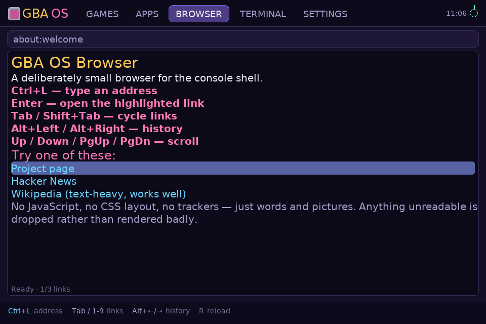

# GBA OS — A Game Boy Advance Inspired Distro (V1)

[](LICENSE)
[-purple.svg)](docs/CONTRACT.md)
[](tests)
[](docs/SAFETY.md)

**GBA OS** is an appliance-style Linux operating system experience designed to turn any PC or laptop into a dedicated Game Boy Advance console.

It completely dispenses with conventional desktop environments (GNOME, KDE, XFCE). When the machine powers on, it boots straight into an authentic retro console game library.


---

## 🎮 Vision & Experience

```text
Power On -> GRUB Menu -> GBA OS -> Game Library -> Play Game -> Return to Library
```

- **Zero Desktop Bloat:** Direct KMS/DRM display output. No window manager, panels, or login screens.
- **Controller-First:** Full gamepad support (including hot-plug) with a keyboard fallback.
- **Managed Saves:** Saves and states are stored per game under `/data/saves/<entry-id>/`, with a
  last-known-good backup that survives a hard power cut.
- **Persistent GRUB Safety:** Rebooting always returns to the GRUB menu so you can easily switch back to your primary desktop OS.
- **Ultra-Lightweight:** Runs well under 500 MB RAM idle, and under 1 GB RAM during emulation.
- **Recoverable:** A text-only recovery console is always reachable when the graphics stack is broken.
- **Full-screen by design:** the shell renders at your display's native resolution and fills the
  whole panel — a 1366x768 laptop and a 4K monitor both look deliberate, with no 480x320 window in
  the middle of the screen.
- **A cartridge shelf for everything:** games, built-in apps and settings pages are all drawn as
  Game Boy Advance cartridges (notched shell, grip ribs, magenta sticker, GBA seal).
- **Five tabs:** GAMES · APPS · BROWSER · TERMINAL · SETTINGS.
- **Terminal and browser built in:** a real PTY shell and a deliberately minimal web reader. Useful
  for fixing a machine with no desktop, and both are stdlib-only.
- **Pendrive import:** plug a stick in, get a prompt, import its ROMs on request — never silently.

---

## 📚 Documentation

- [docs/SAFETY.md](docs/SAFETY.md) — what can and cannot change on your machine.
- [docs/CONTRACT.md](docs/CONTRACT.md) — the boot/storage/handler/failure contract (incl. the
  installation contract, IN1–IN8).
- [docs/DECISIONS.md](docs/DECISIONS.md) — why each rule exists.

## 📸 Screenshots

| Cartridge shelf (GAMES) | Built-in apps (APPS) | Settings |
| :---: | :---: | :---: |
|  |  |  |

| Lightweight browser (BROWSER) | Terminal (TERMINAL) |
| :---: | :---: |
|  | Open **Ctrl+Alt+T** — a real `$SHELL` on a PTY |

---

## ⚙️ Architecture

Built strictly against the specifications in [`docs/CONTRACT.md`](docs/CONTRACT.md) and [`docs/DECISIONS.md`](docs/DECISIONS.md):

```text
PID 1 (init / gba-init)
  └── gba-supervisor      (Headless session manager, outcome classifier, crash-loop guard)
        ├── gba-launcher  (Cartridge-shell desktop; exits on selection to release the display)
        └── mgba-adapter  (Isolated handler running mGBA with dedicated save routing)
```

The shell itself is deliberately small and single-purpose per module:

| Module | Responsibility |
|---|---|
| `src/gba_launcher.py` | window, tabs, cartridge shelf, modals, input routing, launch protocol |
| `src/theme.py` | palettes, TTF font ramp, design-unit scaling, the cartridge renderer |
| `src/config.py` | `settings.json` store, SDL/audio/backlight helpers, display-session resolution |
| `src/gba_terminal.py` | PTY session, ANSI screen emulator, key translation, terminal view |
| `src/gba_browser.py` | HTTP fetch, HTML extraction, text layout, history, URL bar |
| `src/gba_usb.py` | `/proc/mounts` discovery, ROM scan, verified import, background watcher |

### Process Lifecycle
1. **Supervisor** starts and executes `gba-launcher`.
2. When the user confirms a game, `gba-launcher` atomically writes a launch request to
   `/run/gba/launch_request.json` and exits cleanly (exit code `10`).
3. **Supervisor** invokes `mgba-adapter` with an isolated environment:
   - `SYS_CONTRACT=1`
   - `SYS_ENTRY_ID=<hash>`
   - `SYS_CONTENT_PATH=/games/<rom>`
   - `SYS_SAVE_DIR=/data/saves/<hash>/`
   - `SYS_DISPLAY_SCALING=fit|integer`
4. **mgba-adapter** backs up the existing save, resolves the display session (X11 / Wayland / KMS-DRM
   / headless) so mGBA cannot start on a backend with no display, runs mGBA with save routing
   (`-f`, explicit `-C fullscreen=1`), then fsyncs the save files and their directory before exiting.
5. **Supervisor** requests a filesystem `sync`, records the outcome (`clean`, `crash`, `launch-failure`, …),
   and restarts `gba-launcher` focused on the previous game with the outcome banner shown.

A launcher that crashes repeatedly (3 times in 30 s) is not respawned; the supervisor drops into the
recovery console instead (contract rule S7).

---

## 🚀 Usage & Booting

### 0. Install from a USB stick (the normal way)

```bash
make iso-check                    # lists anything missing to build the ISO
sudo make iso                     # builds build/gba-os-<version>-amd64.iso
```

Write the image to a USB stick (**the stick is the only thing that is erased**):

```bash
sudo dd if=build/gba-os-<version>-amd64.iso of=/dev/sdX bs=4M status=progress oflag=sync
```

Boot the stick on the target PC and answer **two questions**:

1. *Where should GBA OS be installed?* — press **Enter** to accept the recommended free
   partition. Options that would destroy your existing system are marked and require the exact
   phrase `ERASE /dev/sdX`.
2. *Install GBA OS on /dev/sdX1, keeping your current system?* — press **Enter** again.

Setup then formats that one partition, copies GBA OS, verifies it, and only then adds a boot menu
entry. If anything fails it prints what state the machine is in — and in every failure before the
boot menu is written, **your computer still starts its usual operating system**.

**"Can this brick my PC?"** No — see [docs/SAFETY.md](docs/SAFETY.md) for the exact list of things
that can change, the installer's nine refusal rules, and the fallback for every component. The short
version:

- the live stick writes only to RAM and to itself;
- the installer refuses the disk it booted from, any mounted partition, any partition that contains
  an operating system, anything under 8 GB, and removable media without explicit consent;
- the bootloader is written last, verified, and never touches UEFI NVRAM or another OS's entry;
- the on-PC installer (`scripts/install.sh`) is dry-run by default and restores the previous
  `grub.cfg` if the regenerated one does not contain its own entry.

### 1. Booting via GRUB (Bare-Metal Console Appliance)
During system boot, select:
```text
GBA OS (V1 Appliance Mode)
```
The machine boots directly into the fullscreen retro GBA console shell.

To return to your normal OS: navigate to **SETTINGS → Reboot to GRUB Menu**. The GRUB menu
appears with your primary operating system still selected as the default.

### 2. Testing in Windowed Mode (Inside an Existing Desktop)
```bash
make deps            # one-off: installs pygame
make run-window      # or ./scripts/launch_desktop.sh
```
The windowed session runs the real supervisor → launcher → emulator chain, so what you test is what
ships. Reboot/poweroff are simulated in this mode so your desktop is never touched.

### 3. Installing on a running Linux machine

```bash
./scripts/install.sh                    # dry-run: prints every change, writes nothing
sudo ./scripts/install.sh --apply       # do it (one confirmation)
sudo ./scripts/install.sh --apply --uninstall
sudo ./scripts/install.sh --apply --repair   # re-copy files, keep saves, restore boot entry
```

To install GBA OS onto a *disk* from an existing system, use the same guided setup the USB stick
runs:

```bash
sudo gba-setup            # guided: pick a target, confirm, done
sudo gba-setup --dry-run  # show the plan without writing
```

Check any machine before or after an install:

```bash
gba-selftest              # PASS/WARN/FAIL per component, with the fix for each FAIL
gba-selftest --json       # same, for scripts
```

The installer:

- copies the runtime into `/opt/gba-distro` and prepares `/data` + `/games`;
- writes the shared keyboard profile to `/data/config/keybindings.json` and `~/.config/mgba`;
- determines the root filesystem UUID and the newest installed kernel instead of hard-coding them;
- hooks tty1 (SysVinit / runit) and appends `GBA OS (console appliance)` plus a
  `GBA OS (safe graphics / recovery)` GRUB entry without changing the default boot target;
- backs up every system file it touches and rolls them back if a later step fails;
- reports missing runtime packages (`python3`, `python3-pygame`, `mgba-sdl`) instead of failing at boot.

---

## 🕹️ Controls

| Action | Controller | Keyboard |
| :--- | :--- | :--- |
| **Navigate the shelf** | D-Pad / Analog Stick | Arrows (grid aware) |
| **Switch tab** | START / shoulder buttons | `Tab`, `Alt+Tab`, `Alt+Shift+Tab` |
| **Open the terminal** | — | `Ctrl+Alt+T` (toggles, works from any tab or dialog) |
| **Launch / Select (A)** | `A` Button (Button 0) | `Enter` / `Z` / `Space` |
| **Back / Cancel (B)** | `B` Button (Button 1) | `Esc` / `X` / `Backspace` |
| **Search library** | — | just start typing (`Backspace` edits, `Esc` clears) |
| **Toggle cartridge/list view** | — | `Ctrl+V` |
| **Help / screenshot** | — | `F1` / `F12` (saved to `DATA/screenshots/`) |
| **Emergency Recovery** | — | boot failure, or **SETTINGS → System → Reboot** after a crash |

Browser: `Ctrl+L` types an address, `Tab` / `1`–`9` pick a link, `Enter` opens it, `Alt+Left` /
`Alt+Right` walk history, `R` reloads, `Up`/`Down`/`PgUp`/`PgDn` scroll.

All ten GBA buttons are remappable under **SETTINGS → Controls → Remap buttons**; the same profile drives both the
shell and mGBA, so a gamepad behaves identically in the two. Reserved shell keys (Esc, Tab, arrows,
Ctrl/Alt) and duplicate assignments are rejected with an inline explanation.

---

## 📂 Managing ROMs, Saves & Settings

- **Games Directory:** `/games/` (sub-folders are allowed)
  Place any `.gba`, `.gbc` or `.gb` file here. Titles are read from the cartridge header, falling
  back to a cleaned-up filename (`Pokemon Emerald (USA).gba` → `Pokemon Emerald`).
  The library rescans automatically; use **SETTINGS → Library → Rescan library** after copying files over.
- **Saves Directory:** `/data/saves/<entry-id>/`
  Save batteries (`.sav`) and savestates live here, keyed by content hash, so renaming a ROM never
  orphans its save. **Apps → Save Manager** shows sizes and can delete a save after confirmation.
- **Pendrive import:** plug the stick in and the shell offers to import its `.gba`/`.gbc`/`.gb`
  files. Nothing is copied until you confirm; existing files are never overwritten (identical files
  are skipped, name clashes get a `(n)` suffix) and every copy is size-verified. Files land in
  `/games/<drive label>/` unless you turn sub-folders off. Mount detection reads `/proc/mounts` and
  `/sys/block`, so it needs no `udisks`/`udev`.
- **Settings:** `DATA/config/settings.json` is the single store (scaling, theme, clock, view mode,
  volume, USB behaviour, launch confirmation). `keybindings.json` and `history.json` live beside it;
  a legacy `display.json` is migrated automatically on first run.

---

## 🧪 Testing & Development

```bash
make test       # 219 tests (headless, no display needed)
make lint       # byte-compile Python + syntax-check every shell script
make selftest   # check *this* machine: interpreter, fonts, pty, display, mGBA, storage, config
make iso-check  # what is missing to build a bootable ISO here
make help       # list every target
```

The suite covers the numbered contract rules directly — library identity and caching (L2, L3, L4, L6),
handler environment isolation (H1), outcome classification (H10), crash-loop handling (S6, S7), orphan
cleanup (S8), save durability and restoration (SV2–SV4), log rotation (ST5), input-profile validation
(I3), ROM import safety (ST7), the settings store and theme system, the ANSI terminal emulator, the
browser's HTML extractor/layout/history, and shell behaviour (tabs, `Alt+Tab`, `Ctrl+Alt+T`, search,
empty state, confirmation-gated launches).

Installer safety has its own suites: `tests/test_installer.py` (every refusal rule, the
copy → verify → bootloader order, dry runs, confirmation gating), `tests/test_setup.py` (which
targets the guided setup offers and recommends, and what it does with a wrong answer), and
`tests/test_safety.py` (shell syntax in the shell that will run it, "no script writes a disk", the
GRUB entry invariants, the ISO builder's loud failure, and the missing-pygame fallback).

Screenshots are generated from the real renderer using synthetic content:

```bash
make screenshots   # regenerates the four README images
```

---

## 🛟 Troubleshooting

| Symptom | What to do |
| :--- | :--- |
| Boots to a black screen | Wait for the 10 s GRUB menu, pick your primary OS, then check `/data/logs/latest.log`. |
| Shell starts but no games | Copy ROMs into `/games/`, then **SETTINGS → Library → Rescan library**. |
| Game starts to a black screen | The adapter now resolves the display session itself (a stale `DISPLAY` or a KMS/DRM driver inside a live desktop is the usual cause) and retries once in a window. Check `/data/logs/latest.log` for `Display session=...` and `[mgba]` lines. |
| Game exits immediately | Check `/data/logs/latest.log` for `[handler]` lines; verify `mgba` is installed (`which mgba`). |
| Pendrive not detected | The filesystem must be mounted (any desktop does that automatically). Open **SETTINGS → Library → Import from USB** and press `R` to rescan. |
| Terminal is unavailable | The shell needs a PTY; check that `/dev/pts` is mounted (`SHELL=/bin/sh src/gba_launcher.py` still works for a quick test). |
| Xbox-style pad exits games | The SELECT+START, Guide, and `Esc` combinations are the system exit gestures — see the launch screen. |
| Everything is broken | At the GRUB menu pick `GBA OS (safe graphics / recovery)`, or add `gba_mode=0` to the kernel line for a normal login prompt. The recovery console (option 4) exports your saves first. |
| A component is missing | Run `gba-selftest`; every FAIL line names the package to install. |
| Install failed half way | Your boot menu was not modified — the machine still starts its usual system. Re-run the setup with another target. |

---

## 📄 License

Apache 2.0 — see [LICENSE](LICENSE). Game Boy Advance is a trademark of Nintendo; this project ships
no ROMs, BIOS files or proprietary assets.
