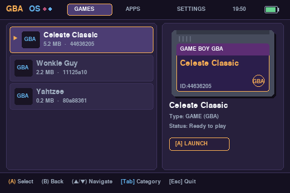
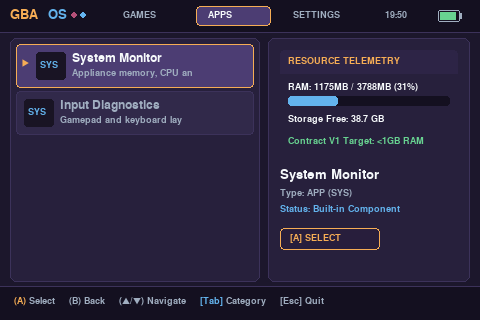
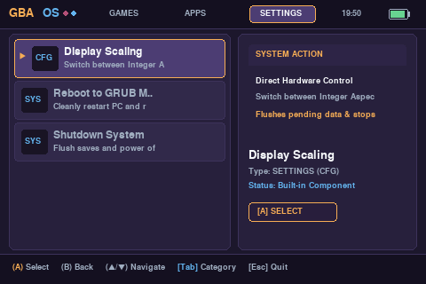

# GBA OS — A Game Boy Advance Inspired Distro (V1)

[](LICENSE)
[-purple.svg)](docs/CONTRACT.md)

**GBA OS** is an appliance-style Linux operating system experience designed to turn any PC or laptop into a dedicated Game Boy Advance console.

It completely dispenses with conventional desktop environments (GNOME, KDE, XFCE). When the machine powers on, it boots straight into an authentic retro console game library.



---

## 🎮 Vision & Experience

```text
Power On -> GRUB Menu -> GBA OS -> Game Library -> Play Game -> Return to Library
```

- **Zero Desktop Bloat:** Direct KMS/DRM display output. No window manager, panels, or login screens.
- **Controller-First:** Full gamepad support with keyboard fallback.
- **Managed Saves:** Saves and states are stored per game under `/data/saves/<entry-id>/` (never scattered in ROM directories).
- **Persistent GRUB Safety:** Rebooting always returns to the GRUB boot menu so you can easily switch back to your primary desktop OS.
- **Ultra-Lightweight:** Runs well under 500 MB RAM idle, and under 1 GB RAM during emulation.

---

## 📸 Screenshots

| Games Library | Resource Telemetry (Apps) | System Actions (Settings) |
| :---: | :---: | :---: |
|  |  |  |

---

## ⚙️ Architecture

Built strictly against the specifications in [`docs/CONTRACT.md`](docs/CONTRACT.md) and [`docs/DECISIONS.md`](docs/DECISIONS.md):

```text
PID 1 (init / gba-init)
  └── gba-supervisor      (Headless session manager, outcome classifier, hotkey listener)
        ├── gba-launcher  (Pixel-art retro shell; exits on selection to release display)
        └── mgba-adapter  (Isolated handler running mGBA with dedicated save routing)
```

### Process Lifecycle
1. **Supervisor** starts and executes `gba-launcher`.
2. When the user confirms a game, `gba-launcher` writes a launch request to `/run/gba/launch_request.json` and exits cleanly.
3. **Supervisor** invokes `mgba-adapter` with isolated environment variables:
   - `SYS_CONTRACT=1`
   - `SYS_ENTRY_ID=<hash>`
   - `SYS_CONTENT_PATH=/games/<rom>`
   - `SYS_SAVE_DIR=/data/saves/<hash>/`
4. When the user exits the game, `mgba-adapter` fsyncs the save data and terminates.
5. **Supervisor** executes a filesystem `sync`, records the outcome (`clean`, `error`, etc.), and restarts `gba-launcher` at the previous game.

---

## 🚀 Usage & Booting

### 1. Booting via GRUB (Bare-Metal Console Appliance)
During system boot, select:
```text
GBA OS (V1 Appliance Mode)
```
The machine will boot directly into the fullscreen retro GBA console shell.

To return to your normal OS:
1. Navigate to **SETTINGS** -> **Reboot to GRUB Menu**.
2. When the laptop reboots, the standard GRUB menu appears with your primary operating system as the default.

### 2. Testing in Windowed Mode (Inside Existing Desktop)
You can also launch and test GBA OS directly in your current desktop environment without rebooting:
```bash
./scripts/launch_desktop.sh
```
Or double-click the **GBA OS (Windowed Test)** desktop icon.

---

## 🕹️ Controls

| Action | Controller | Keyboard |
| :--- | :--- | :--- |
| **Navigate** | D-Pad / Analog Stick | `Up` / `Down` Arrow keys |
| **Switch Category** | D-Pad Left/Right | `Tab` or `Shift + Tab` |
| **Launch / Select (A)** | `A` Button (Button 0) | `Enter` / `Z` / `Space` |
| **Back / Cancel (B)** | `B` Button (Button 1) | `Esc` / `X` / `Backspace` |
| **Emergency Recovery** | System Key | Boot Recovery Shell |

---

## 📂 Managing ROMs & Saves

- **Games Directory:** `/games/`
  Place any `.gba`, `.gbc`, or `.gb` files here. The library scans and computes SHA-256 identifiers automatically.
- **Saves Directory:** `/data/saves/<entry-id>/`
  Save batteries (`.sav`) and savestates are stored safely here, untouched by file renames.

---

## 🧪 Testing

Run the automated contract verification test suite:
```bash
make test
```
